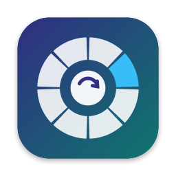

<p align="center"></p>

<h1 align="center">Rondo</h1>

<p align="center">Convert, compress and edit files without leaving Finder.<br>
Drag a file, tap a key, drop it on the wheel. Free and open source.</p>

---

## How it works

Rondo lives in your menu bar. While you drag files anywhere in macOS, tap a key and a wheel appears under your cursor:

| Tap while dragging | Wheel | Examples |
|---|---|---|
| **⇧ Shift** | **Convert** | HEIC → JPG, MOV → MP4, DOCX → PDF, SRT → VTT |
| **⌥ Option** | **Tools** | Compress, resize, crop, trim, merge PDFs, strip metadata |
| **⌃ Control** | **Actions** | AirDrop, Float, Copy, Move, Copy Path, Open in Terminal |

Drop on a slice and Rondo saves the result **next to the original** (`photo.jpg`, `photo 2.jpg` if that name is taken). Originals are never modified.

Other ways in: drop files on the menu-bar icon, select files in Finder and press **⌃⌥Space**, or park files on the floating shelf and drop them later. All keys can be remapped in Settings.

## What it handles

| Kind | Convert | Tools |
|---|---|---|
| Images | JPG, PNG, HEIC, WebP, AVIF, TIFF, GIF, BMP, PDF (SVG in) | Compress (quality or exact size), resize, crop/rotate, adjust, annotate, redact, background, metadata, QR reader, images → PDF, collage |
| Video | MP4, MOV, MKV, WebM, AVI, WMV, GIF, MP3 (M4V in) | Compress, trim, crop, speed, split, join, snapshot, extract audio, strip metadata |
| Audio | MP3, M4A, WAV, FLAC, OGG, Opus, AIFF, WMA | Compress, normalize, trim, bleep, channels, strip metadata |
| PDF | JPG, PNG (300 DPI), TXT, Markdown, DOCX, EPUB | Compress, merge, split, reorder/rotate/delete pages, extract text (with OCR), strip metadata |
| Documents | DOCX, DOC, RTF, RTFD, TXT, Markdown, HTML, ODT, text clippings → DOCX, TXT, MD, HTML, RTF, PDF, EPUB | |
| Spreadsheets | CSV, TSV, XLSX → each other, PDF | |
| Subtitles | SRT ↔ VTT, → TXT | |
| Archives | Folders/files → ZIP, TAR, TAR.GZ, GZIP; extract ZIP, TAR, GZ, RAR | |

Editors open for hands-on tools: an image editor (crop, adjust, annotate, redact, background), a video/audio editor (trim, split, crop, snapshot, speed, bleep) and a PDF organizer (reorder, rotate, delete, split, merge order).

## Privacy

Everything runs on your Mac. Rondo makes no network requests and collects no analytics.

## Install

1. Download **Rondo-x.y.z.zip** from [Releases](../../releases/latest), unzip it, and drag **Rondo.app** to **Applications**.
2. **First launch.** Rondo is a free project and isn't notarized by Apple, so macOS blocks it the first time. Open **System Settings → Privacy & Security**, scroll to the message about Rondo, and click **Open Anyway**. Or in Terminal:
   ```bash
   xattr -dr com.apple.quarantine /Applications/Rondo.app
   ```
3. **Optional helpers** (via [Homebrew](https://brew.sh)) unlock video/audio and WebP/AVIF/SVG:
   ```bash
   brew install ffmpeg imagemagick
   ```
   Without them, the options that need them simply don't appear. Office slides convert when Keynote or LibreOffice is installed.

Verify a download: `shasum -a 256 Rondo-x.y.z.zip` must match the `.sha256` file on the release page.

**Requirements:** macOS 13 Ventura or later, Apple Silicon or Intel.

### Permissions (all optional)

| Permission | Used for |
|---|---|
| Accessibility | Arrow keys / Enter on the wheel *while dragging* |
| Automation (Finder) | The keyboard shortcut that acts on the Finder selection |
| Automation (Terminal) | The "Terminal" action |

Settings → Permissions shows the status and opens the right System Settings pane. Dragging, dropping and converting need no permissions.

## Build from source

Requires macOS 13+ and a Swift 6 toolchain (Xcode or just the Command Line Tools).

```bash
git clone https://github.com/FarazBukhari/rondo.git
cd rondo
scripts/run.sh            # debug build → build/Rondo.app → launch
scripts/install.sh        # release build → /Applications/Rondo.app
scripts/test.sh           # test suite (Swift Testing)
scripts/smoke.sh          # convert every generated fixture through every engine
```

`swift run rondo-cli` exposes the same engines headlessly (`list`, `matrix`, `convert`, `tool`). The architecture and engine contracts are in [docs/ARCHITECTURE.md](docs/ARCHITECTURE.md).

Local builds are ad-hoc signed. To keep macOS permission grants across rebuilds, create a self-signed code-signing certificate named `Rondo Dev` in Keychain Access; `scripts/install.sh` uses it automatically.

### Releasing

1. Bump `CFBundleShortVersionString` in `Resources/Info.plist` and add a section to `CHANGELOG.md`.
2. `git tag vX.Y.Z && git push origin vX.Y.Z`. The Release workflow builds a universal app, zips it, and publishes it with checksums and notes.

## Contributing

Issues and pull requests are welcome. Please run `scripts/test.sh` before opening a PR.

## License

[MIT](LICENSE) © 2026 Faraz Bukhari.

Rondo calls [FFmpeg](https://ffmpeg.org) and [ImageMagick](https://imagemagick.org) when you have them installed. They are not bundled and keep their own licenses.
